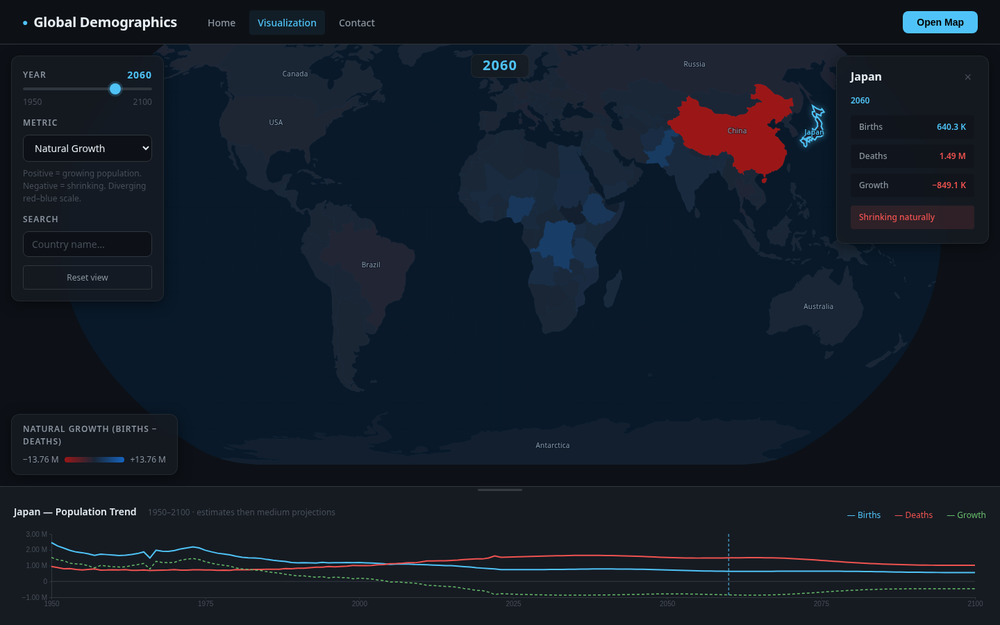
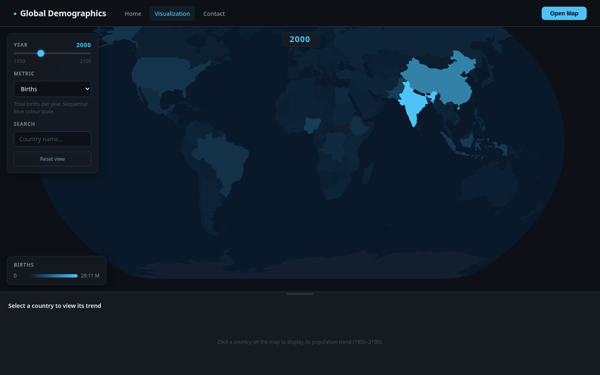
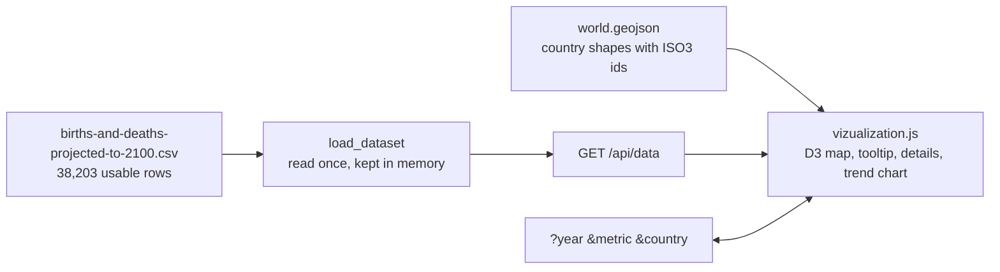

<div align="center">

# VitalMap

**Births, deaths and natural population growth for every country, 1950 to 2100, on one world map.**

Drag the year, pick a metric, click a country. The address bar keeps up, so any view is a link you can send.




<sub><code>/visualization?year=2060&metric=natural_growth&country=JPN</code></sub>

</div>

---

## What you can do with it

| | |
|---|---|
| **Slide through 150 years** | Estimates up to 2023, then the medium projection to 2100. The map recolours as you drag. |
| **Three metrics** | Births (blue), deaths (red) and natural growth, births minus deaths, on a red-to-blue scale that turns at zero. |
| **Click a country** | Its figures for the year, "Growing naturally" or "Shrinking naturally", and a trend chart of all 150 years with a marker on the year you are at. |
| **Search** | Type two letters, pick a country, the map pans to it. |
| **Send a view** | The year, metric and country are in the address. Copy it and the other person opens the same view. |
| **Resize the chart** | Drag the handle above the trend panel. |



## Run it

```bash
git clone https://github.com/DevCrazyCube/VitalMap
cd VitalMap

python -m venv .venv
source .venv/bin/activate          # Windows: .venv\Scripts\activate
pip install -r requirements.txt

python app.py                      # http://127.0.0.1:5000
```

The only Python dependency is Flask. The page loads D3 and GSAP from a CDN, so the browser needs a connection;
the dataset and the country shapes are in the repo.

## Links you can share

| Parameter | Values | Without it |
|---|---|---|
| `year` | `1950` to `2100` | `2000` |
| `metric` | `births`, `deaths`, `natural_growth` | `births` |
| `country` | an ISO 3166-1 alpha-3 code: `NLD`, `JPN`, `BRA` | nothing selected |

```text
/visualization?year=2023&metric=natural_growth&country=NLD
/visualization?year=1960&metric=births
```

A value the page does not know is ignored, so a mistyped link opens the default view and not an error. The
address changes in place as you use the map; it does not fill your browser's history.

## Settings

| Variable | What it does | Default |
|---|---|---|
| `SECRET_KEY` | Signs the session cookie that carries the form's "sent" and "fill in all fields" messages. Set it to keep sessions across restarts. | a new random key at every start |
| `FLASK_DEBUG` | `1` turns on Flask's debugger and reloader. | off |

```bash
SECRET_KEY="$(python -c 'import secrets; print(secrets.token_hex(32))')" python app.py
FLASK_DEBUG=1 python app.py
```

The debugger lets anyone who can open the page run code on the machine, so it is off unless you ask for it.

## How it works



Each row of the file has two columns per measure, an estimate and a medium projection. The app takes the
estimate where there is one and the projection otherwise, drops rows that have neither, and sends
`entity`, `code`, `year`, `births`, `deaths`, `natural_growth`. The join to the map is the ISO3 code. All
drawing happens in the browser; the server only serves the pages and that one JSON answer.

| Method | Route | |
|---|---|---|
| GET | `/` | Landing page: a scroll story that leads into the map |
| GET | `/visualization` | The map |
| GET, POST | `/contact` | Contact form; a message is added to `submissions/messages.json` |
| GET | `/api/data` | The whole dataset as JSON |

## Tests

```bash
python -m unittest discover -s tests
```

Fourteen tests on Flask's test client; no server and no browser are started.

| | Checks |
|---|---|
| Pages | every page answers, an unknown one is a 404 |
| Dataset | six fields a row, 1950 to 2100, growth equals births minus deaths, an estimate wins over a projection, one row per country and year, the API sends the same rows, the file is read once |
| Contact | a full message is saved with a UTC time, a second is added to the first, a missing field saves nothing, a broken file does not stop a new message |
| Config | no key is written in the source |

The tests write contact messages to a temporary file, never to `submissions/`. The map itself is not under
test: the two screenshots above were taken from the running app.

<details>
<summary><b>Repo layout</b></summary>

```
app.py                       the Flask app: pages, /api/data, the contact form
requirements.txt             flask
tests/test_app.py            14 tests
templates/
  base.html                  layout, navbar, the D3 and GSAP script tags
  home.html                  landing page
  visualization.html         the map page: controls, details card, trend panel
  contact.html               contact form
static/
  css/variables.css          design tokens
  css/styling.css            every component and page style
  js/main.js                 nav, flash messages, number formatting
  js/home.js                 the landing page's GSAP animations
  js/vizualization.js        the map, shareable links, tooltip, details, trend chart
  data/births-and-deaths-projected-to-2100.csv
  data/world.geojson
docs/                        the screenshots in this README
submissions/                 contact messages (git-ignored)
```

</details>

## Data

| | |
|---|---|
| Births and deaths | `static/data/births-and-deaths-projected-to-2100.csv`, from [Our World in Data](https://ourworldindata.org/). 253 countries and regions, 238 of them with an ISO3 code. |
| Country shapes | `static/data/world.geojson`, Natural Earth 110 m polygons, each with its ISO3 code as `id`. |

Everything after 2023 is a projection, not a measurement. The map has 177 shapes; 67 small countries and
territories in the dataset (Aruba, Andorra, Bahrain, Barbados and others) have none at this resolution. They are
in `/api/data`, but there is nothing to click.

## Limits

- Made to run on your own machine. Contact messages are kept in one JSON file with no lock, so two messages at
  the same instant can lose one. Put a real store behind it before hosting it for other people.
- `/api/data` sends the whole dataset in one answer of a few megabytes. Fine locally; on a slow connection the
  map waits for it.
- Totals, not rates. A large country is darker than a small one with the same birth rate.

## License

MIT
